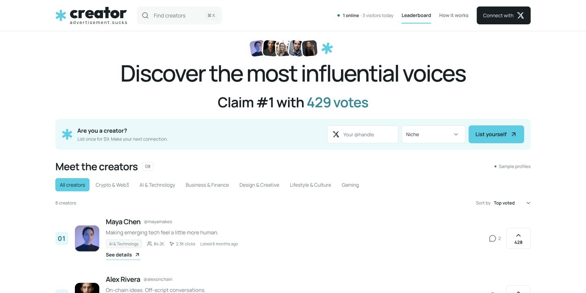
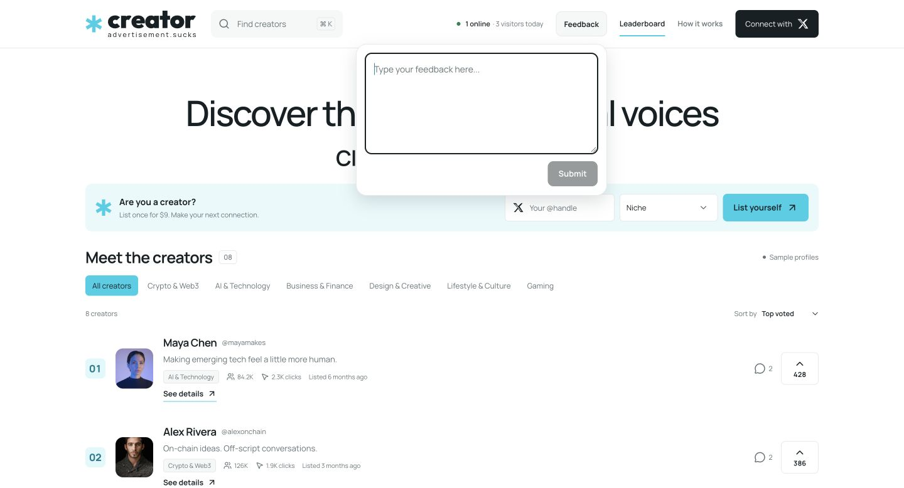

# Creator tool

**A tool for ranking creators.**

A creator discovery app built by [0xDominoGirl](https://github.com/0xDominoGirl), bringing profiles, niches, service rates and community rankings into one place.



## The idea

Brands should be able to find creators, understand their work and reach them directly. Creators should have a profile they can share and a place where community support helps them get discovered.

## What I built

- A responsive directory with search, niche filters and creator profiles.
- Service-rate displays, contact options and direct X profile links.
- X sign-in through Privy and server-verified voting for live listings.
- Rankings ordered by votes, with earlier listings winning ties.
- A review interface with a 500-character limit and incremental loading.
- A feedback form that saves messages privately and handles retries safely.



## Technical choices

The interface uses React and TypeScript, with Next.js-compatible routing through Vinext and Vite. Cloudflare Workers and D1 handle the implemented backend endpoints, and Drizzle manages schema migrations.

Voting uses verified account identity and a database uniqueness constraint. Feedback uses submission IDs to avoid duplicate records when a request is retried. These are small details that make the interface behave reliably beyond a screenshot.

## Status

Work in progress, currently in a private preview. Production profile editing and shared reviews still need completion. The screenshots use fictional sample profiles and demonstration counts; they do not represent real customers or traction. The directory screenshot predates the later Feedback navigation addition.

The intended domain is `creator.advertisement.sucks`. Creator is separate from the advertisement.sucks vending-machine project.

## A small piece of the implementation

[`lib/ranking.ts`](lib/ranking.ts) contains the application's ranking logic: highest vote count first, earlier listing first when scores tie, then creator ID for a deterministic final tie-break. It also calculates how many votes a challenger needs to overtake the leader.

[`tests/ranking.test.mjs`](tests/ranking.test.mjs) checks empty boards, ties, the current leader, and vote thresholds. It uses fictional test entries; no member or production voting data is included.

```sh
# Node.js 24 or later; no dependencies to install
npm test
```

The TypeScript utility is copied from the private application. The original regression assertions are preserved, with a direct TypeScript import using Node's built-in type stripping instead of the application's transpilation harness. Input validation and authenticated vote storage live in the private backend.

## About this repository

This is a project overview containing a product description, screenshots and one small source excerpt with tests. The full application source is maintained privately. No production data or credentials are included.

Sample portraits come from Unsplash. Third-party imagery and trademarks remain the property of their respective owners; this repository grants no license to those assets.
